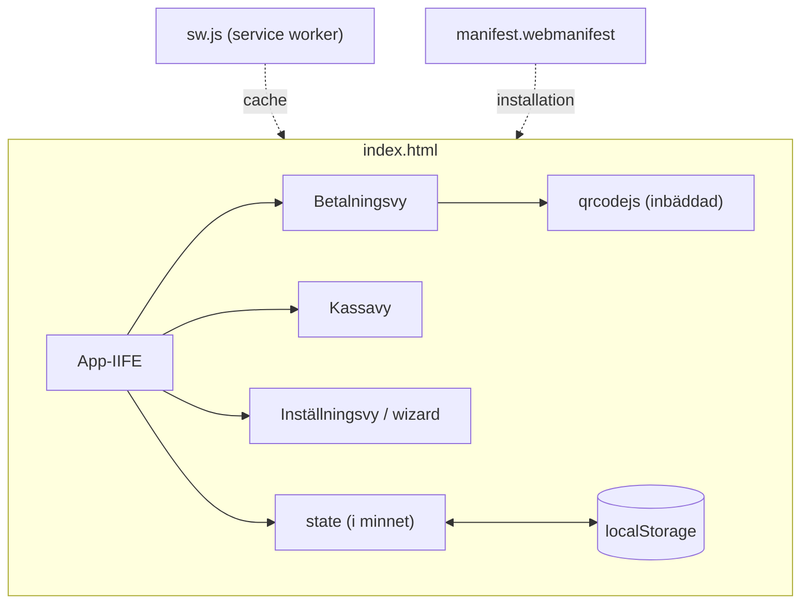
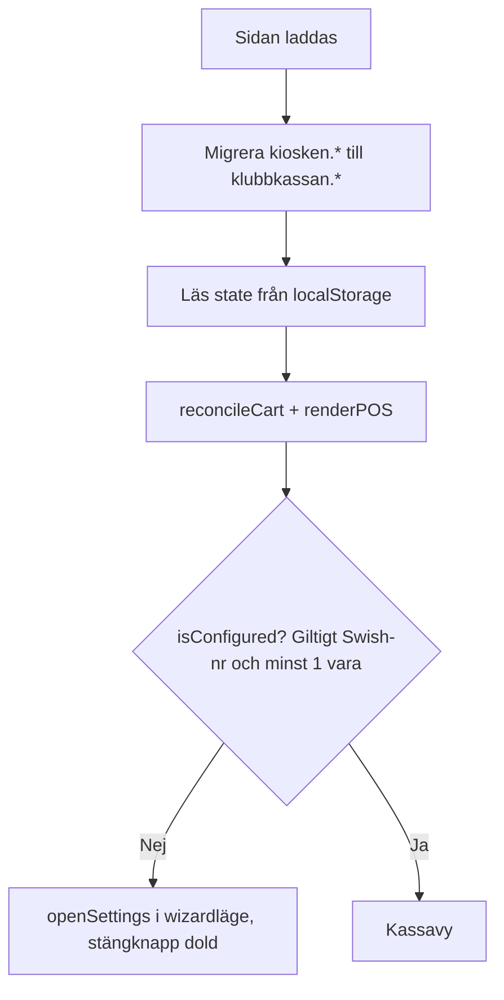
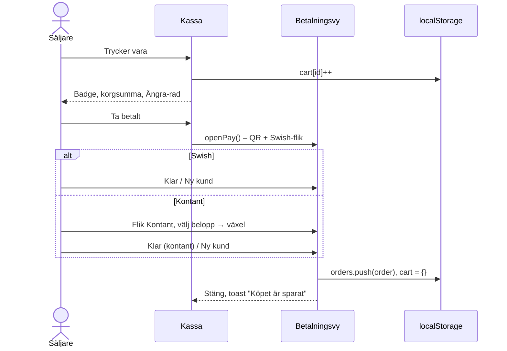

# Klubbkassan – teknisk dokumentation

Dokumentet beskriver arkitektur, datamodell, flöden och implementationsdetaljer för Klubbkassan. Det riktar sig till den som ska underhålla, vidareutveckla eller driftsätta appen.

---

## 1. Översikt

| Egenskap | Värde |
|---|---|
| Typ | Fristående single-page webbapp (en HTML-fil) |
| Språk | HTML5, CSS3, JavaScript (ES2017+, ingen transpilering) |
| Ramverk | Inga |
| Beroenden | [qrcodejs 1.0.0](https://github.com/davidshimjs/qrcodejs) (MIT), **inbäddad** i `index.html` |
| Backend | Ingen |
| Lagring | `window.localStorage` |
| Byggsteg | Inget |
| Offline | Ja – fullt fungerande utan nät; service worker vid publicering via http(s) |
| UI-språk | Svenska (`lang="sv"`, `sv-SE`-formatering) |

### Filstruktur

```
/
├── index.html              Hela appen (markup, CSS, JS, qrcodejs)
├── manifest.webmanifest    PWA-manifest (laddas endast via http/https)
├── sw.js                   Service worker – offline-cache (endast http/https)
├── icon.svg                Appikon/logga
├── .nojekyll               Stänger av Jekyll på GitHub Pages
├── README.md               Användardokumentation
└── docs/
    └── TEKNISK-DOKUMENTATION.md
```

`index.html` är självförsörjande. Övriga filer är valfria och används bara när appen publiceras på en webbserver.

---

## 2. Arkitektur



All applogik ligger i en enda IIFE (`(function () { 'use strict'; ... })()`) i det andra `<script>`-blocket. Det finns inga globala variabler utöver `QRCode` från biblioteket.

### Renderingsmodell
Appen använder en enkel *state → render*-modell utan virtuell DOM:

1. En händelse (klick, input) muterar `state`.
2. Ändrad del av state sparas med `save(KEY, value)`.
3. Berörda render-funktioner anropas och skriver om sin del av DOM:en via `innerHTML` (alla användardata passerar `esc()`).

Händelser hanteras med **event delegation** på containerelement (`#catalog`, `#cartPanel`, `#menuList`, `#statsCard`, `#cashQuick`) och `data-*`-attribut.

### Vyer

| Vy | Element | Visas när |
|---|---|---|
| Kassa | `#posView` | Alltid i bakgrunden |
| Varukorg (drop-down) | `#cartPanel` + `#cartBackdrop` | Tryck på korgknappen i headern |
| Ångra-rad | `#undoBar` | I 4 s efter att en vara lagts till |
| Inställningar / wizard | `#settingsView` | Kugghjulet, eller automatiskt om appen inte är konfigurerad |
| Betalning | `#payView` | "Ta betalt" |

Vyer växlas med attributet `hidden` (CSS: `[hidden] { display: none !important; }`). `lockScroll()` sätter `body.locked` när en överliggande vy är öppen.

---

## 3. Datamodell (localStorage)

Alla nycklar har prefixet `klubbkassan.` och lagras som JSON.

| Nyckel | Typ | Beskrivning |
|---|---|---|
| `klubbkassan.settings` | `Settings` | Mottagare, namn, meddelande |
| `klubbkassan.menu` | `MenuItem[]` | Varor i visningsordning |
| `klubbkassan.orders` | `Order[]` | Genomförda köp (äldst först) |
| `klubbkassan.cart` | `Record<itemId, number>` | Pågående korg (överlever omladdning) |

```ts
interface Settings {
  swish: string;     // normaliserat, endast siffror: "1231234567" | "0701234567"
  title: string;     // namn på kassan, default "Klubbkassan"
  message: string;   // betalningsmeddelande, default "Kiosk"
}

interface MenuItem {
  id: string;        // uid(): base36-tid + slump
  name: string;      // max 30 tecken
  price: number;     // heltal kronor, 1–100 000
}

interface Order {
  id: string;
  ts: number;                        // Date.now()
  items: { name: string; price: number; qty: number }[];  // ögonblicksbild
  total: number;                     // kronor
  method?: 'swish' | 'cash';         // saknas på äldre köp → tolkas som 'swish'
  received?: number;                 // endast kontant, om mottaget belopp angavs
}
```

**Designval:**
- Korgen refererar till `MenuItem.id`, så prisändringar slår igenom direkt. `reconcileCart()` tar bort rader vars vara raderats.
- `Order.items` är en *kopia* av namn och pris vid köptillfället, så historiken påverkas inte av senare menyändringar.

### Migrering
Vid start flyttas data från den tidigare versionens nycklar (`kiosken.*`) till `klubbkassan.*` om de nya saknas; de gamla nycklarna tas sedan bort. Om `settings.title === 'Kiosken'` (gammalt standardnamn) ersätts det med `Klubbkassan`.

### Felhantering
- `load()` returnerar fallback-värde vid saknad eller korrupt JSON.
- `save()` fångar `QuotaExceededError` m.fl. och visar en toast.

---

## 4. Flöden

### 4.1 Uppstart



I wizardläge (inget Swish-nummer sparat) visas välkomstkortet och rubriken "Kom igång". Stängknappen (✕) och Escape är inaktiva tills `isConfigured()` är sant.

### 4.2 Försäljning



**Avbryt** stänger betalningsvyn utan att röra korgen.

### 4.3 Ångra
- `undoStack` (max 30 poster) fylls med `itemId` vid varje tryck på en varuknapp.
- Raden visar `+N <vara>` där N är antalet identiska poster i följd överst i stacken.
- **Ångra** poppar en post och minskar antalet med 1 (om varan finns i korgen).
- Timern (`UNDO_MS = 4000`) startas om vid varje tryck/ångra. Vid timeout töms stacken.
- Stacken töms också när korgen öppnas/rensas, betalning öppnas eller köp slutförs.

### 4.4 Kontant
- `cashSuggestions(total)`: `total` ("Jämnt") samt `total` avrundat uppåt till närmaste 10, 20, 50, 100, 200, 500, 1000 (endast värden > total). Unika, sorterade, max 6.
- `cashReceived` är `null` (inget angivet) eller ett heltal.
- `cashReceived < total` → "Saknas X kr" och **Klar**-knappen inaktiveras.
- `null` tillåts – tolkas som jämnt belopp.

---

## 5. Swish

### 5.1 Validering av mottagarnummer
`normalizeSwish(raw)`:
1. Tar bort allt utom siffror och `+`.
2. `+46…` / `0046…` → `0…`; `467XXXXXXXX` → `07XXXXXXXX`.
3. Tar bort kvarvarande icke-siffror.

`swishError(num)` godkänner:

| Typ | Regex | Exempel |
|---|---|---|
| Swish Företag/förening | `^123\d{7}$` | `1231234567` |
| Swish Privat | `^07\d{8}$` | `0701234567` |

Visningsformat (`formatSwish`): `123 456 78 90` respektive `070-123 45 67`.

### 5.2 QR-kod (format C)

```
C<nummer>;<belopp>;<meddelande>;<lås>
```

| Fält | Värde i Klubbkassan |
|---|---|
| `C` | Prefix för förifylld betalning |
| nummer | `settings.swish` (normaliserat) |
| belopp | Korgens total i hela kronor |
| meddelande | `qrMessage(settings.message) + ' #' + refCode` |
| lås | `0` – inga fält redigerbara för betalaren |

Exempel: `C1231234567;45;Kiosk P14 #B27;0`

Appen genererar en unik 3-teckens kontrollkod (`#B27`) vid varje Swish-betalning. Koden visas i kassan och ingår i betalningsmeddelandet, vilket gör det enkelt för personalen att verifiera att kunden genomfört rätt betalning och inte visar en gammal skärmdump eller bluff-app.

`qrMessage()` saneras eftersom:
- `;` är fältavgränsare → ersätts med `,`.
- qrcodejs lägger till en UTF-8 BOM (`EF BB BF`) i datat om strängen innehåller multibyte-tecken, vilket kan göra att Swish-appen inte tolkar koden. Därför: Unicode-normalisering (NFD), diakritiska tecken tas bort (å→a, ö→o), övriga icke-ASCII-tecken filtreras bort, längd max 50.

QR genereras med felkorrigering **M**, svart på vitt, storlek `max(180, min(innerWidth − 80, innerHeight × 0.38, 340))` px, med vit "quiet zone" via CSS-padding. Om `QRCode` saknas eller kastar fel visas ett felmeddelande och numret i text.

> **Obs:** Appen kan inte verifiera att betalningen har genomförts. Det kräver Swish Handel (API med certifikat) och en backend, vilket ligger utanför projektets ramar.

### 5.3 Dela och klona meny via QR-kod
För att snabbt sätta upp flera mobiler i samma kiosk utan konto, databas eller server:
1. Säljare 1 trycker på **Dela meny till annan mobil** under Meny i Inställningar.
2. Appen serialiserar `state.settings` och `state.menu` till en kompakt URL-safe Base64-sträng i URL-fragmentet (`#setup=<data>`).
3. En QR-kod genereras med felkorrigering **L** så att mobilkameror enkelt kan skanna den.
4. Säljare 2 skannar koden med sin vanliga mobilkamera och öppnar länken.
5. Klubbkassan känner av hashen, visar en bekräftelsedialog med förhandsgranskning av kassan, och läser in meny och Swish-nummer med ett tryck.
6. URL-fragmentet rensas därefter med `history.replaceState()`. All data stannar 100 % lokalt i webbläsaren.

---

## 6. Offline & PWA

### Utan server (`file://`)
Allt fungerar eftersom qrcodejs är inbäddad. Manifest och service worker laddas **inte** (webbläsare tillåter det inte för `file://`).

### Med server (`http(s)://`)
Vid start (endast om `location.protocol` är `http:`/`https:`):
1. `<link rel="manifest" href="manifest.webmanifest">` injiceras.
2. `sw.js` registreras vid `load`.
3. `beforeinstallprompt` fångas → knappen **Installera på hemskärmen** visas i Inställningar.

**`sw.js`**
- Cache-namn: `klubbkassan-v5`. **Höj versionen** vid ändring av cachade filer så att gamla cacher rensas i `activate`.
- Förcachar: `./`, `./index.html`, `./manifest.webmanifest`, `./icon.svg`, `./apple-touch-icon.png`, `./icon-192.png`, `./icon-512.png`.
- Strategi: *stale-while-revalidate* för GET-anrop till samma origin. Navigeringar faller tillbaka till `index.html`.
- `skipWaiting()` + `clients.claim()` → ny version aktiveras direkt; användaren ser den vid nästa omladdning.

**Favicon** är en inbäddad SVG-data-URI i `<head>` och fungerar även lokalt.

### Skärmlås
I betalningsvyn begärs `navigator.wakeLock.request('screen')` (där det stöds) så att skärmen inte slocknar medan kunden skannar. Låset släpps när vyn stängs och begärs på nytt vid `visibilitychange`.

---

## 7. Försäljningsstatistik & export

Beräknas vid varje öppning av Inställningar från `state.orders`:
- Antal köp, total, Swish-total/antal, kontant-total/antal.
- Per vara (grupperat på **namn**): antal och summa, sorterat på summa fallande.
- De 10 senaste köpen med möjlighet att ta bort enskilda köp.

### CSV
- Avgränsare `;`, radslut `\r\n`, UTF-8 med BOM (för korrekt å/ä/ö i svensk Excel).
- En rad per orderrad:

```
Datum;Tid;Order-ID;Betalsätt;Vara;Antal;Styckpris;Summa
2026-10-20;16:12:01;mvgs13gemruj0;Kontant;Kaffe;2;15;30
```

- Fält som innehåller `;`, `"` eller radbrytning citeras.
- Filnamn: `klubbkassan-forsaljning-ÅÅÅÅ-MM-DD.csv`.

---

## 8. UI & design

### Designtokens (CSS custom properties i `:root`)

| Variabel | Värde | Användning |
|---|---|---|
| `--bg` | `#f2f3f5` | Bakgrund |
| `--surface` | `#ffffff` | Kort, paneler |
| `--text` | `#0b0b0c` | Text |
| `--muted` | `#55585e` | Sekundär text |
| `--dark` | `#111214` | Header, varuknappar |
| `--green` / `--green-dark` | `#08873a` / `#066a2d` | Betala, bekräftelse, varumärke |
| `--red` | `#c4161c` | Fel, radera |
| `--amber` | `#f5b400` | Fokusram, Ångra, slogan |
| `--header-h` | `64px` | Headerhöjd (används för positionering av korgpanel) |

### Principer
- **Mobile first** med `grid-template-columns: repeat(auto-fill, minmax(150px, 1fr))` för varuknapparna (190px från 900px bredd).
- Minsta tryckyta 46–48 px; primära knappar 64–76 px.
- `user-select: none` och `touch-action: manipulation` på knappar (förhindrar markering och dubbeltrycks-zoom). Zoom är *inte* avstängd i viewport, av tillgänglighetsskäl.
- `env(safe-area-inset-bottom)` för telefoner med hemindikator.
- Högkontrast för solljus: vit text på `#111214`, grön accent med kontrast ≥ 4.5:1 mot vitt.
- Haptik via `navigator.vibrate()` där det stöds (Android).

### Tillgänglighet
- `aria-label` på ikonknappar, `aria-expanded` på korgknappen, `role="dialog"`/`aria-modal` på betalningsvyn, `role="tablist"`/`aria-selected` på betalsättsflikarna, `aria-live` på ångra-raden.
- Synlig fokusmarkering (`:focus-visible`, gul ram).
- **Escape** stänger i ordning: betalningsvy → korg → inställningar (om konfigurerad och ingen vara redigeras).

### Varumärke
- Namn: **Klubbkassan**. Slogan: *Kassan för föreningens kiosk, café och evenemang*.
- Logga: grön sköld med vit bock på mörk bakgrund (`icon.svg`, även inline i välkomst- och Om-kortet samt favicon).
- Använd inte "Swish" i namn/logga (registrerat varumärke, Getswish AB). Funktionsbeskrivningen "Betala med Swish" är OK.

---

## 9. Kodstruktur (`index.html`, app-scriptet)

| Sektion (kommentar i koden) | Innehåll |
|---|---|
| `Lagring` | `KEYS`, `BRAND`, migrering, `load()`, `save()`, `DEFAULT_MENU`, `state` |
| `Hjälpfunktioner` | `$`, `uid`, `kr`, `esc`, `vibrate`, `toast`, `normalizeSwish`, `swishError`, `formatSwish`, `qrMessage`, `parsePrice`, korgberäkningar, `reconcileCart`, `lockScroll` |
| `Kassa` | `renderCatalog`, `renderCart`, `renderPOS`, `changeQty`, varuklick |
| `Ångra senaste tryck` | `undoStack`, `pushUndo`, `showUndo`, `hideUndo` |
| korg | `openCart`, `closeCart`, händelser i korgpanelen |
| `Betalning` | wake lock, `openPay`, `closePay` |
| `Betalsätt: Swish / Kontant` | `setPayMethod`, `cashSuggestions`, `renderCash`, `updateDoneBtn`, `completePayment` |
| `Inställningar` | `isConfigured`, `openSettings`, `closeSettings`, Swish-validering i fält |
| `Menyhantering` | `renderMenuList`, `persistMenu`, `saveEdit`, flytta/redigera/ta bort, lägg till |
| `Försäljningsöversikt` | `renderStats`, `exportCSV`, rensa/ta bort köp |
| `Standardmeny & spara` | Ladda standardmeny, spara-knappen |
| `Tangentbord` | Escape-hantering |
| `PWA / offline` | Manifest-injektion, SW-registrering, installationsknapp, `renderAppStatus` |
| `Start` | Titelmigrering, första rendering, ev. wizard |

### Konfigurerbara konstanter

| Konstant | Plats | Standard |
|---|---|---|
| `BRAND` | Lagring | `'Klubbkassan'` |
| `DEFAULT_MENU` | Lagring | Kaffe 15, Festis 10, Kaka 10, Toast 25, Korv med bröd 20 |
| `UNDO_MS` | Ångra | `4000` |
| Standardmeddelande | `state.settings`, spara | `'Kiosk'` |
| Cache-version | `sw.js` → `CACHE` | `'klubbkassan-v5'` |

---

## 10. Säkerhet & integritet

- Ingen data lämnar enheten; inga nätverksanrop görs av appen.
- All användarinmatning som renderas via `innerHTML` escapas med `esc()`; övrig text sätts med `textContent`.
- Inga cookies, ingen analys/spårning, inga tredjepartsskript vid körning.
- `localStorage` är inte krypterat. Den som har tillgång till enheten/webbläsaren kan läsa försäljningshistoriken.

---

## 11. Driftsättning

**Produktion:** GitHub Pages från grenen `main` (rot), https://lukasgavelin.github.io/klubbkassan/. Filen `.nojekyll` gör att filerna publiceras som de är, utan Jekyll-bearbetning. Varje push till `main` publiceras automatiskt inom någon minut.

Egen driftsättning:

1. Ladda upp alla filer till samma katalog på en statisk webbserver med HTTPS (GitHub Pages, Netlify, Cloudflare Pages m.fl.).
2. Inga serverinställningar krävs. `manifest.webmanifest` bör helst serveras som `application/manifest+json` (de flesta värdar gör det automatiskt).
3. Vid uppdatering: ändra `CACHE` i `sw.js` (t.ex. `klubbkassan-v4`) så att klienter hämtar nya filer.

### Uppdatera qrcodejs
Biblioteket ligger i första `<script>`-blocket i `index.html` med en kommentar om källa och licens. Ersätt innehållet med ny minifierad version. Kontrollera att koden inte innehåller strängen `</script`.

---

## 12. Testning

Det finns ingen automatiserad testsvit. Rekommenderad manuell checklista:

- [ ] Första start utan data → wizard visas, stängknapp dold.
- [ ] Ogiltigt Swish-nummer (t.ex. `12312`, `0812345678`) → felmeddelande, kan ej spara.
- [ ] `+46 70 123 45 67` normaliseras till `070-123 45 67`.
- [ ] Spara utan varor → "Lägg till minst en vara".
- [ ] Lägg till, redigera, flytta, ta bort vara; standardmeny ersätter efter bekräftelse.
- [ ] Varuklick → badge, korgsumma, ångra-rad; Ångra minskar rätt vara.
- [ ] Korg: + / − / ta bort rad / rensa.
- [ ] Ta betalt inaktiv vid tom korg.
- [ ] QR skannas i Swish-appen med rätt mottagare, belopp och meddelande.
- [ ] Kontant: snabbval och eget belopp ger rätt växel; för lite → Klar inaktiv.
- [ ] Klar → köp i statistik med rätt betalsätt; korgen tom.
- [ ] Omladdning behåller inställningar, meny, korg och historik.
- [ ] CSV öppnas korrekt i Excel (å/ä/ö, kolumner).
- [ ] Publicerad version: installerbar, fungerar i flygplansläge.

---

## 13. Kända begränsningar & idéer

**Begränsningar**
- Endast hela kronor.
- Ingen verifiering av Swish-betalning.
- Ingen synk mellan enheter; data per webbläsare.
- Statistik per vara grupperas på namn (byter en vara namn räknas den som ny).

**Möjliga vidareutvecklingar**
- Kategorier/färger på varor, lagersaldo, paketpriser.
- Kassaskift med rapport per pass.
- Dela meny/inställningar mellan enheter via QR/länk.
- PIN-lås för inställningar, mörkt läge, backup/återställning av all data.
